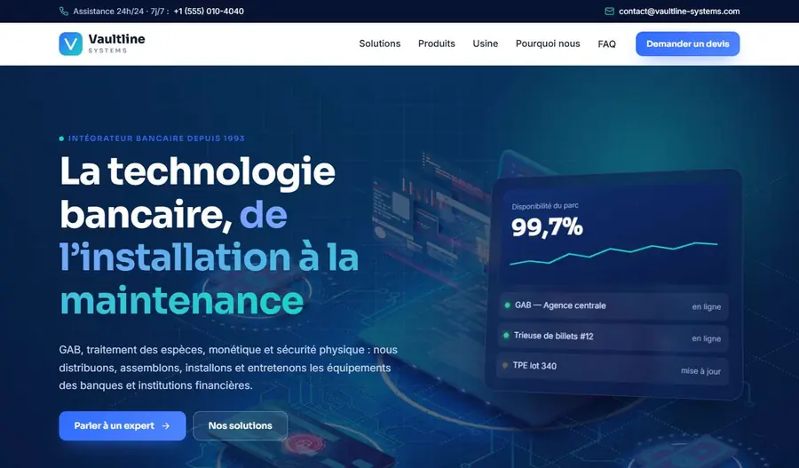

# Modèle entreprise fintech — Vaultline Systems

Corporate website template for a banking-technology company (French): solutions, filterable catalogue, comparison table, FAQ. Plain HTML/CSS/JS.

**Live demo:** https://abdelmoulabilel.github.io/fintech-company-template/

**Built by:** [Bilel Abdelmoula](https://bilelabdelmoula.dev), full-stack developer.

## Use it
- Click **Use this template** on GitHub (or download the ZIP), then open `index.html` — no install, no build.
- Publish for free: repo **Settings → Pages → Deploy from branch → main / root**.

## Customise
Textes dans `index.html`, couleurs dans `css/style.css` (`:root`).
Catalogue produits et e-mail de contact : en haut de `js/main.js` (`PRODUCTS`, `CONTACT_EMAIL`).
Les clients affichés (Banque Atlas, etc.) sont fictifs.

## Credits
Code: MIT licence (see `LICENSE`). Photos come from earlier client projects or theme demos and are for demonstration only — replace them with your own images.
